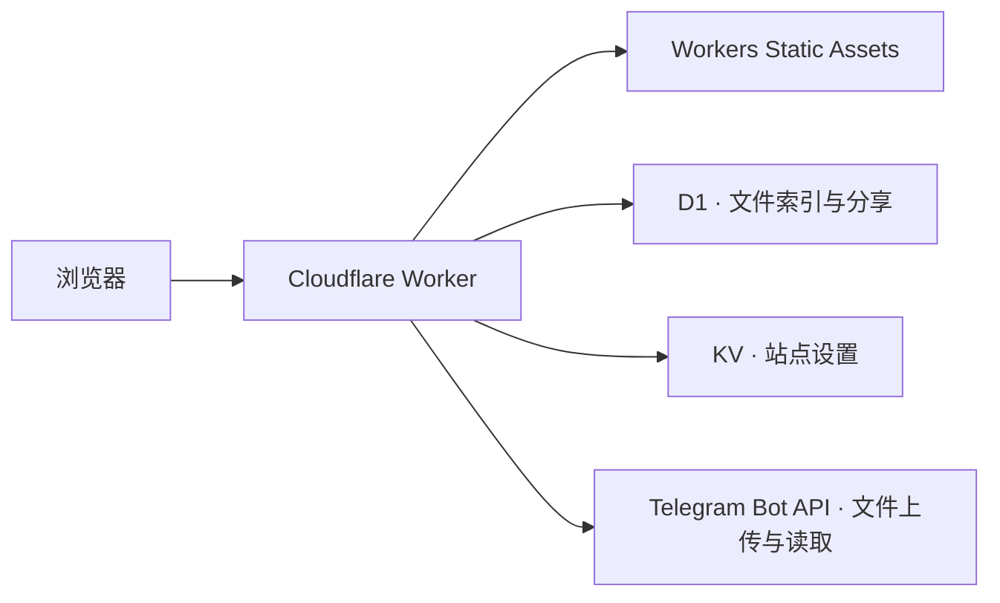

# 技术文档

## 架构

前端使用原生 HTML、CSS 和 JavaScript 模块。Worker 使用 Web API 处理请求，静态资源与 API 共用一个域名。`wrangler.jsonc` 定义资源绑定，并将 `/api/*`、`/s/*` 和旧分享路径 `/f/*` 交给 Worker。

| 路径 | 职责 |
| --- | --- |
| `src/worker.js` | 鉴权、数据库初始化和迁移、文件管理、分享路由、Telegram 代理 |
| `public/index.html`、`public/app.js` | 管理端 |
| `public/inbox.html`、`public/inbox.js` | 公开目录、目录树、访客上传 |
| `public/html-preview.js`、`public/media-types.js` | 浏览器预览及文件类型判断 |
| `src/document-renderers.js`、`src/workbook-*.js` | 文档及工作簿渲染 |

预览构建由 esbuild 打包。Markdown 使用 Marked，文档渲染使用 DOMPurify 清理内容，DOCX 使用 docx-preview，XLSX 使用 read-excel-file 和 JSZip。生成的 `public/document-renderers.js` 由构建流程产出。

## 数据模型

D1 的 `entries` 表保存文件和目录。根级项目的 `parent_id` 为 `NULL`。

| 字段 | 用途 |
| --- | --- |
| `id`、`parent_id`、`kind` | 项目标识、父目录、文件或目录 |
| `name`、`mime`、`size`、`tags` | 名称、媒体类型、字节数及 JSON 标签 |
| `telegram_file_id`、`telegram_message_id`、`telegram_chat_id` | 下载文件和定位 Telegram 原消息 |
| `share_code`、`share_expires_at` | 12 位短码及到期时间，永久分享的到期时间为 `NULL` |
| `created_at`、`deleted_at` | 创建和软删除时间 |

KV 使用 `site:config` 保存 `title`、`description` 和 `maxUploadMiB`。运行时密钥由 Worker 环境提供。

首次访问数据库相关接口时会初始化表。升级旧版 D1 时，Worker 会补齐仍有效分享的短码、保留已有短码和有效期，然后移除旧的 `share_token` 字段。

## 请求流程

- **上传**。浏览器按文件提交请求。Worker 校验目标目录和单文件大小，通过 Telegram `sendDocument` 存入频道，再写入 D1。文件夹上传先建目录，再逐个上传文件。
- **下载**。Worker 从 D1 查到 `file_id`，调用 Telegram `getFile`，然后将文件响应转发给浏览器。Telegram Bot Token 保留在服务端。
- **分享**。`/s/<code>` 校验短码和有效期。访问公开目录内的子项目时，Worker 校验目标是否属于该公开目录。撤销分享会清除短码。
- **删除**。先在 D1 软删除项目及子项目并撤销分享，再尝试同步删除 Telegram 原消息。Telegram 对消息删除有时间及权限限制，管理端会提示未确认删除的数量。[Telegram Bot API](https://core.telegram.org/bots/api#deletemessage)

## HTTP 接口

管理员接口使用 `Authorization: Bearer <ADMIN_TOKEN>`。公开接口通过短码授权，访问者可以新建目录和上传。重命名、移动、删除等操作需要管理员权限。

| 方式 | 路径 | 用途 |
| --- | --- | --- |
| GET | `/api/health` | 检查 Worker 是否响应 |
| GET / PUT | `/api/config` | 读取公开设置 / 管理员修改设置 |
| GET | `/api/session` | 校验管理员密钥 |
| GET | `/api/entries` | 管理端列表、搜索和分页 |
| GET / POST | `/api/folders` | 读取目录树 / 新建目录 |
| POST | `/api/upload?parent=<id>&name=<name>` | 上传文件，正文为文件字节 |
| PATCH / DELETE | `/api/entries/<id>` | 修改项目 / 删除项目 |
| GET | `/api/entries/<id>/download` | 管理员下载 |
| GET | `/api/links` | 管理端分享列表 |
| GET | `/s/<code>` | 打开公开文件夹或单文件分享 |
| GET | `/api/inbox/<code>?folder=<id>&offset=<n>` | 浏览公开目录 |
| POST | `/api/inbox/<code>?folder=<id>&name=<name>` | 访客上传文件 |
| POST | `/api/inbox/<code>?folder=<id>&action=mkdir` | 访客新建目录，JSON 正文包含 `name` |
| GET | `/api/inbox/<code>/<id>/download` | 下载公开目录内的文件 |
| GET | `/api/share/<code>/download` | 下载单独分享的文件 |

公开目录请求省略 `folder` 时，使用该分享的根目录。

## 运维与排查

- **登录失败**。核对生产环境的 `ADMIN_TOKEN`，以及正在访问的 Worker 地址。
- **后台和访客均无法上传**。检查生产环境的 Telegram Bot Token、频道 ID 和 Bot 发消息权限。用小文件确认基本流程。
- **分享打开后显示失效**。在链接管理中核对分享状态、有效期和域名。旧版长链接已停用。
- **文件夹上传部分失败**。查看页面列出的失败路径。20 MiB 是单文件默认上限，文件夹内的文件逐个上传。拖放可以保留空目录，文件夹选择器取决于浏览器返回的文件路径。
- **备份和迁移**。保留 D1 索引、KV 配置及 Telegram 频道和 Bot 的访问权限。D1 导出包含文件索引和分享短码，文件本体仍在 Telegram。旧版 Prisma 数据库需要单独迁移。
